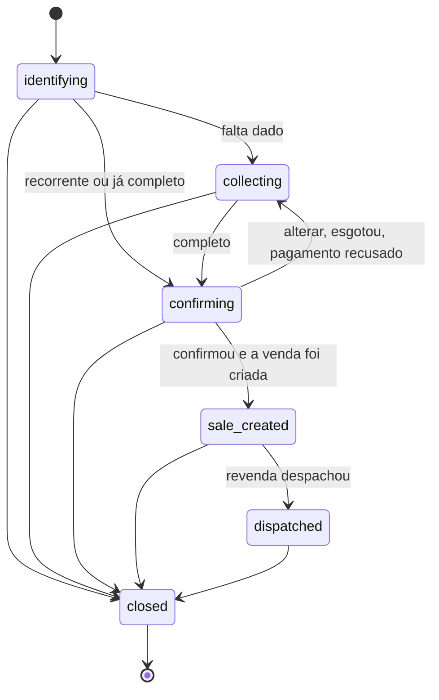

# Máquina de estados da conversa

- **Issue:** #6
- **Código:** [`src/conversation`](../src/conversation)

O código decide o próximo passo. O LLM só preenche campos ([ADR 0003](adr/0003-extracao-com-llm.md)); botões nem passam por ele.

## Etapas e transições

A tabela fica em [`transitions.ts`](../src/conversation/transitions.ts). Qualquer transição fora dela lança `IllegalTransitionError`, e o turno não é gravado.

| Etapa | Handler | O que faz |
|-------|---------|-----------|
| `identifying` | [`identifying.handler.ts`](../src/conversation/handlers/identifying.handler.ts) | Busca o cliente pelo telefone. Recorrente: último pedido num resumo só (confirma com um toque), sem reaproveitar produto esgotado nem pagamento desativado. Telefone fora do cadastro: cliente novo |
| `collecting` | [`collecting.handler.ts`](../src/conversation/handlers/collecting.handler.ts) | Aplica o que veio e pergunta o próximo campo: produto, endereço, pagamento, nome (só cliente novo) |
| `confirming` | [`confirming.handler.ts`](../src/conversation/handlers/confirming.handler.ts) | Resumo com Confirmar, Alterar e Cancelar; cria cliente (se novo) e venda |
| `sale_created` | [`after-sale.handlers.ts`](../src/conversation/handlers/after-sale.handlers.ts) | Cancelar pelo bot; o resto informa o status |
| `dispatched` | idem | Cancelar ou reclamar vai para o atendente |
| `closed` | idem | Final |

## Regras de qualquer etapa

- **Atendente:** pedir atendente encerra com passagem (handoff). Depois disso o bot só registra as mensagens, sem responder, até a sessão expirar.
- **Não entendeu:** repete a pergunta com botões; na segunda vez seguida, passa para o atendente.
- **RevGás fora do ar:** mantém etapa e rascunho e oferece atendente. Falha só no `POST /sales` mantém o resumo para tentar de novo.
- **LLM fora do ar ou no limite:** o turno segue como "não entendeu", com botões.

## Sessão

- Uma conversa ativa por contato (canal + telefone).
- **Expiração:** sem mensagem por `CONVERSATION_TTL_MINUTES` (padrão 30), a sessão é encerrada. Sem venda, conta como abandono; com venda, como concluída. Isso acontece na chegada da próxima mensagem e numa varredura a cada minuto.
- **Idempotência:** mensagem com `externalId` repetido não é processada de novo.
- **Ordem:** turnos do mesmo contato rodam um de cada vez.

## Provisório (fica para outras issues)

| Ponto | Hoje | Issue |
|-------|------|-------|
| Preço | Último pedido para o recorrente; tabela fictícia por peso para o resto, porque a API não tem preço | #9, pergunta 2 da #1 |
| Catálogo | Consultado a cada turno, sem cache | #9 |
| "Um maior" / "um menor" | Mostra os produtos em botões | #9 |
| Pagamento | Botões com todas as formas aceitas, menos fiado e vale gás | #10 |
| Endereço | Até 3 conhecidos (últimas vendas + cadastro) em botões, ou digitado; sem cobertura nem localização | #11 |
| Cancelamento | Usa o primeiro motivo cadastrado | #12 |
| Atendente | Sem resumo, sem horário de funcionamento, sem painel | #13 |
| Despacho | `ConversationService.notifyDispatched`, ainda sem quem chame | #13, #16 |
