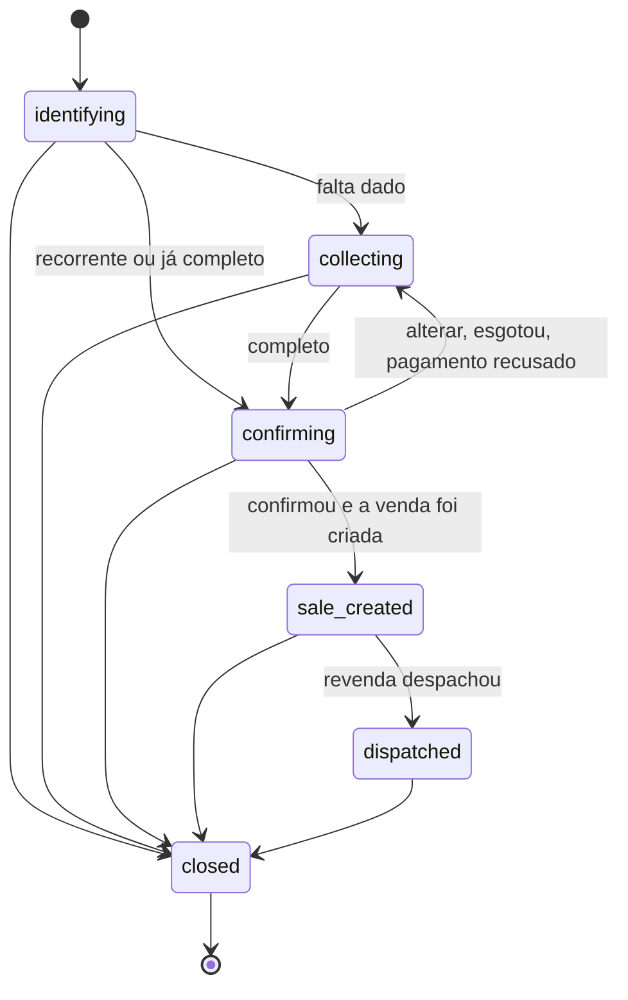

# Máquina de estados da conversa

- **Issue:** #6
- **Código:** [`src/conversation`](../src/conversation)

O código decide o próximo passo. O LLM só preenche campos ([ADR 0003](adr/0003-extracao-com-llm.md)); botões nem passam por ele.

## Etapas e transições

A tabela fica em [`transitions.ts`](../src/conversation/transitions.ts). Qualquer transição fora dela lança `IllegalTransitionError`, e o turno não é gravado.

| Etapa | Handler | O que faz |
|-------|---------|-----------|
| `identifying` | [`identifying.handler.ts`](../src/conversation/handlers/identifying.handler.ts) | Busca o cliente pelo telefone. Recorrente: último pedido num resumo só (confirma com um toque), sem reaproveitar produto esgotado nem pagamento desativado. Telefone fora do cadastro: cliente novo |
| `collecting` | [`collecting.handler.ts`](../src/conversation/handlers/collecting.handler.ts) | Aplica o que veio e pergunta o próximo campo: produto, endereço, pagamento, nome (só cliente novo) |
| `confirming` | [`confirming.handler.ts`](../src/conversation/handlers/confirming.handler.ts) | Resumo com Confirmar, Alterar e Cancelar; cria cliente (se novo) e venda |
| `sale_created` | [`after-sale.handlers.ts`](../src/conversation/handlers/after-sale.handlers.ts) | Cancelar pelo bot; o resto informa o status |
| `dispatched` | idem | Cancelar ou reclamar vai para o atendente |
| `closed` | idem | Final |

## Cliente novo (issue #8)

- **Uma mensagem com vários dados:** faltando dois ou mais campos, o bot pede todos juntos ("me diga numa mensagem só: botijão, endereço, pagamento, nome"), com os botões do primeiro campo de opções fechadas. Faltando um, pergunta só ele.
- **CPF:** na NFC-e o CPF do consumidor é opcional, então por padrão o bot não pede nem guarda. Com `CPF_REQUIRED=true`, pede só a cliente novo, valida os dígitos verificadores e mostra mascarado no resumo. Quem lê o CPF é o código: a resposta ao pedido de CPF não passa pelo LLM, e CPF no meio de outra mensagem vira `[cpf]` antes de ir ao Groq. No banco, a mensagem fica com o CPF mascarado, e ele sai do rascunho assim que o cadastro é criado.
- **Cadastro com confirmação:** o resumo mostra o nome e avisa que o cadastro e o endereço ficam salvos. O cliente só é criado na RevGás depois do Confirmar. Se a venda falhar logo depois, o ID já criado é mantido, para a nova tentativa não duplicar o cadastro.
- **Endereço novo de cliente antigo:** depois da venda, o bot pergunta se salva o endereço no cadastro (Salvar / Agora não). O `PUT` reenvia o cadastro atual inteiro, trocando só o endereço.

## Catálogo, preço e estoque (issue #9)

- **Catálogo:** produtos e formas de pagamento vêm da API, com cache de `CATALOG_CACHE_SECONDS` (padrão 120). Turnos simultâneos esperam a mesma carga.
- **Preço:** a API da RevGás não tem preço de produto. A revenda configura `PRODUCT_PRICES=P13:120,P20:180` (decimal com ponto). Sem tabela, o mock usa preços de demonstração e o modo real não vende nada, para o bot nunca inventar preço.
- **"Um maior" / "um menor":** o próximo tamanho à venda a partir do produto atual, pulando o que está sem estoque. Sem produto atual, ou "quero outro" sem dizer qual, mostra os produtos em botões.
- **Estoque:** a quantidade é conferida contra o estoque ao escolher. No Confirmar, o código consulta o estoque na API, sem cache, antes do cadastro e da venda.
- **Sem estoque:** oferece os outros produtos à venda e o atendente; nunca cria a venda. Se a RevGás recusar a venda por estoque, o cache é descartado e as opções são reabertas. Com mais de 3 opções, o canal mostra lista (WhatsApp, #18).

## Pagamento (issue #10)

- **Formas:** só as cadastradas e ativas na revenda, lidas da API. Ordem: a do último pedido, depois dinheiro, Pix, débito e crédito. Boleto, transferência e cheque não aparecem (cobrança antecipada, fora do protótipo).
- **Botões ou lista:** toda resposta com até 3 opções vai em botões; com mais, em lista (`presentation`), limite do WhatsApp.
- **Fiado e vale gás:** só para cliente autorizado. Hoje: fiado com `credit_limit` no cadastro; vale gás com categoria do cliente contendo "vale gás". Cliente novo não tem nenhum. Botão forjado de forma não liberada é ignorado.
- **Troco:** "troco para 100" vale só para dinheiro; aparece no resumo e vai na observação da venda.
- **Pix fictício:** só no modo mock, depois da venda com Pix, um "copia e cola" marcado como demonstração. Duas travas: a chave é de um domínio `.invalid`, que não existe, e o CRC é invertido de propósito, para o banco recusar o código ([`pix-demo.ts`](../src/payments/pix-demo.ts)). No modo real, Pix é na entrega.
- **Recusa:** simulada no mock. A venda não é criada (nada é despachado); o bot oferece outra forma, sem a recusada; na segunda recusa, atendente.

## Alterar produto e endereço (issue #11)

- **Antes de confirmar:** trocar produto ou quantidade recalcula o total do resumo.
- **Endereço:** digitado, escolhido entre os salvos ou pela localização do WhatsApp. Localização com endereço escrito (local compartilhado) passa pelo extrator. Só o ponto no mapa: as coordenadas ficam guardadas para o entregador e o bot pede rua, número e bairro. Não usamos serviço de geocodificação, para a localização não ir a mais um terceiro. No banco, a mensagem fica só como `[localização]`.
- **Área de entrega:** a revenda configura bairros (`COVERAGE_NEIGHBORHOODS`) e/ou um raio em volta da loja (`COVERAGE_CENTER` + `COVERAGE_RADIUS_KM`). Vale o bairro na lista ou o ponto dentro do raio. Sem regras, tudo é atendido. Fora da área, o endereço não é aceito e o bot oferece outro endereço ou o atendente. Endereços salvos fora da área não aparecem como opção, e o do último pedido não é reaproveitado.
- **Depois da venda, antes do despacho (PRD 6.1):** o bot propõe a alteração com o novo total e só chama `PUT /sales/{id}` depois do "Confirmar alteração". Revalida cobertura e estoque (consulta na hora, contando só o que aumenta). Se a RevGás recusar (ex.: venda já confirmada), passa para o atendente.
- **Depois do despacho:** produto não muda; endereço só com atendente.

## Regras de qualquer etapa

- **Atendente:** pedir atendente encerra com passagem (handoff). Depois disso o bot só registra as mensagens, sem responder, até a sessão expirar.
- **Não entendeu:** repete a pergunta com botões; na segunda vez seguida, passa para o atendente.
- **RevGás fora do ar:** mantém etapa e rascunho e oferece atendente. Falha só no `POST /sales` mantém o resumo para tentar de novo.
- **LLM fora do ar ou no limite:** o turno segue como "não entendeu", com botões.

## Sessão

- Uma conversa ativa por contato (canal + telefone).
- **Expiração:** sem mensagem por `CONVERSATION_TTL_MINUTES` (padrão 30), a sessão é encerrada. Sem venda, conta como abandono; com venda, como concluída. Isso acontece na chegada da próxima mensagem e numa varredura a cada minuto.
- **Idempotência:** mensagem com `externalId` repetido não é processada de novo.
- **Ordem:** turnos do mesmo contato rodam um de cada vez.

## Provisório (fica para outras issues)

| Ponto | Hoje | Issue |
|-------|------|-------|
| Preço | `PRODUCT_PRICES` configurado pela revenda (a API não tem preço); recorrente paga o do último pedido. Sem tabela: demonstração no mock, nada à venda no modo real | pergunta 2 da #1 |
| Fiado e vale gás | Fiado com limite de crédito no cadastro; vale gás com categoria "vale gás" (suposição) | pergunta 13 da #1 |
| Área de entrega | Configurada pela revenda (`COVERAGE_*`); a API não tem | pergunta 6 da #1 |
| Entregue | Sem estado de entrega ainda: alteração e cancelamento depois da entrega | #12 |
| Cancelamento | Usa o primeiro motivo cadastrado | #12 |
| Atendente | Sem resumo, sem horário de funcionamento, sem painel | #13 |
| Despacho | `ConversationService.notifyDispatched`, ainda sem quem chame | #13, #16 |
